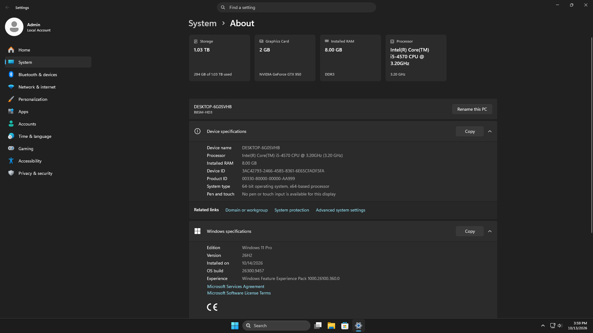
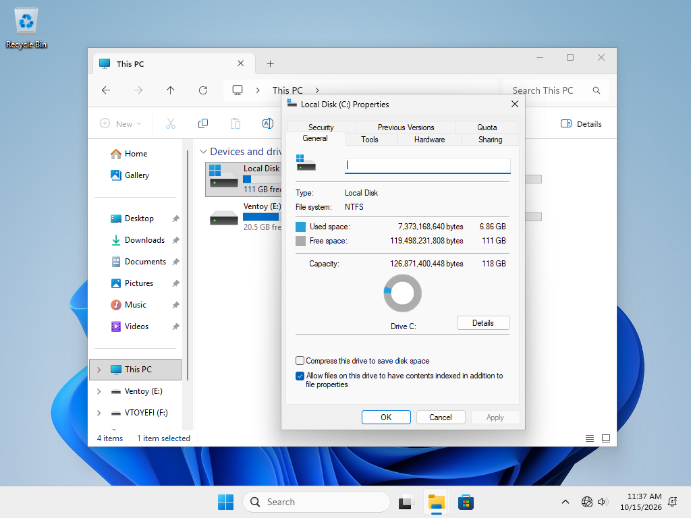
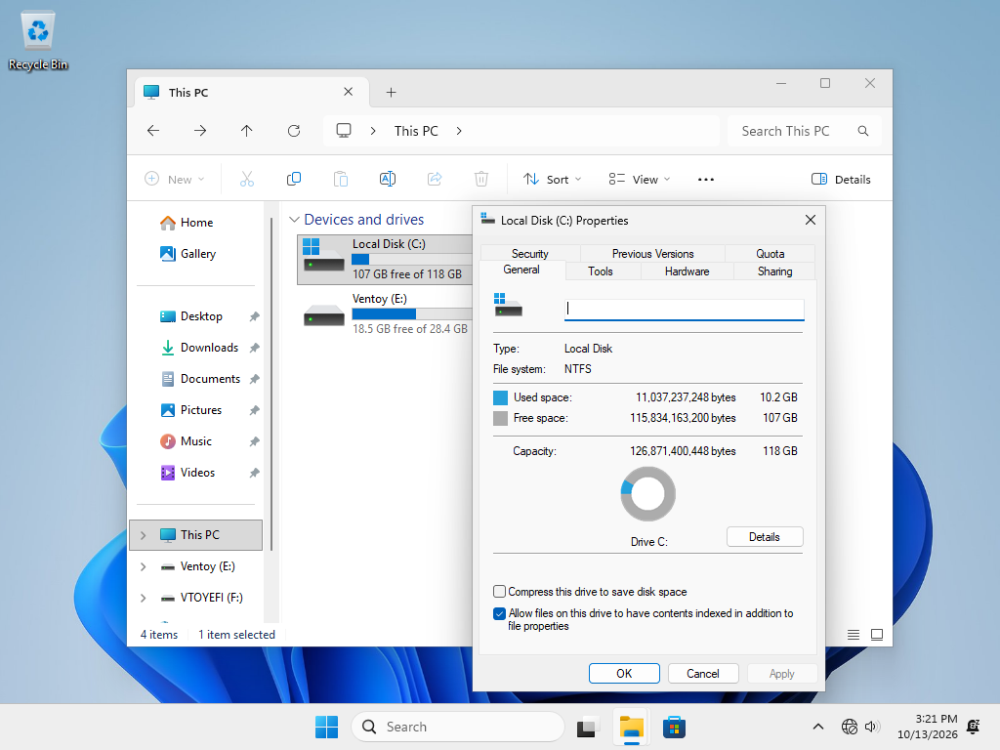
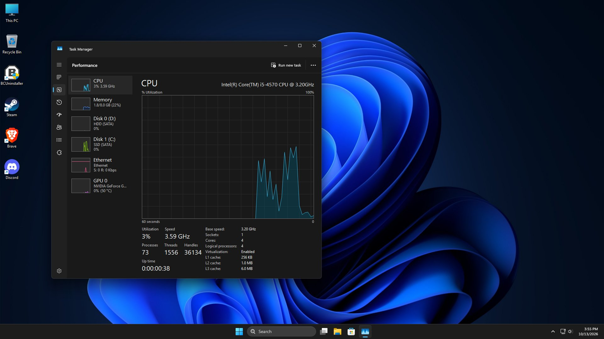

# Tiny11 Automated Builder

[](https://github.com/kelexine/tiny11-automated/actions/workflows/build-tiny11.yml)
[](https://github.com/kelexine/tiny11-automated/actions/workflows/build-tiny11-core.yml)
[](https://github.com/kelexine/tiny11-automated/actions/workflows/build-nano11.yml)
[](https://github.com/kelexine/tiny11-automated/actions/workflows/build-tiny11-core-gaming.yml)
[](https://sourceforge.net/projects/tiny-11-releases/files/latest/download)
[](LICENSE)

[](https://github.com/sponsors/kelexine)
[](https://www.buymeacoffee.com/kelexine)


[](CODE_OF_CONDUCT.md)

**Automated tools for creating streamlined Windows 11 images with CI/CD support.**

<div align="center">

[🚀 Quick Start](#-quick-start) • [📥 Download](#-downloads) • [📖 Documentation](#-documentation) • [🤝 Contributing](#-contributing) • [💬 Community](#-community)

</div>

---

## 📸 What You Get

Real screenshots from a Tiny11 build — a near-empty, fast, bloat-free Windows 11 running on modest hardware (Intel Core i5-4570 / 8 GB RAM / NVIDIA GTX 950):

<table>
  <tr>
    <td align="center" width="50%">
       About"><br>
      <sub><b>Windows 11 Pro, 26H2</b> — build 26300.9457, full edition intact</sub>
    </td>
    <td align="center" width="50%">
      <br>
      <sub><b>~7 GB install footprint</b> — Tiny11 Core-Gaming, 111 GB free on a 118 GB drive</sub>
    </td>
  </tr>
  <tr>
    <td align="center" width="50%">
      <br>
      <sub><b>~10 GB with apps installed</b> — still 107 GB free</sub>
    </td>
    <td align="center" width="50%">
      <br>
      <sub><b>Near-idle resources</b> — 3% CPU, 1.8 GB RAM, no background bloat</sub>
    </td>
  </tr>
</table>

> 💡 Footprint varies by variant and edition — **Standard** keeps more, **Core** and **Nano** go lower still. See the **Choose Your Variant** section below.

---

## 📊 Project Stats

- **📦 Total Downloads**: 261436 (and growing!)
- **🌍 Active Users**: 261436 worldwide
- **✅ Build Success Rate**: 100%
- **⏱️ Average Build Time**: ~30-50 minutes
- **💾 ISO Size Reduction**: Up to 50% smaller (Windows 11 26H2)

## 🆕 What's New (January 2026)

**🎮 Tiny11 Core-Gaming — new variant:**
- ⚡ **AtlasOS-style power scheme**: no CPU idle (C-State 0), no core parking, no USB/PCIe power saving
- 🎯 **Latency-first tweaks**: Game Mode off, Fullscreen Optimizations off, MPO off, mouse acceleration off
- 🔓 **Security mitigations off**: VBS / Memory Integrity / Credential Guard / Spectre-Meltdown
- 🔁 **Reversible**: ships an undo script and a per-build manifest inside the ISO
- 📖 Full details in **[GAMING.md](GAMING.md)**

**Windows 11 26H2 Optimizations:**
- ✨ **AI/Recall Removal**: Complete removal of Copilot, Recall, and AI Fabric (~220 MB saved)
- 🛡️ **Enhanced Telemetry Blocking**: Stronger privacy protection with additional registry tweaks
- 🎮 **VRAM Gaming Optimization**: Improved graphics performance through DirectX registry optimizations
- ⚡ **Build-Specific Service Removal**: 4 services (Standard), 13 services (Core), 14 services (Nano)
- 🚫 **Windows Update Binary Removal**: Core/Nano builds now remove WU binaries (~300 MB saved)

**Total Additional Savings:**
- Standard: ~120 MB
- Core: ~320 MB
- Nano: ~320 MB

---

## 📋 Overview

Tiny11 Automated Builder provides **production-ready PowerShell scripts** to create minimized Windows 11 ISO images by:

✨ **Removing bloatware** (40+ unnecessary apps)  
🔒 **Disabling telemetry** (complete privacy protection)  
⚡ **Optimizing performance** (faster boot, less resource usage)  
🤖 **Full CI/CD automation** (GitHub Actions workflows)  
🛠️ **System requirement bypass** (TPM, CPU, RAM checks removed)

**Three variants** available: **Standard** (daily use), **Core** (ultra-minimal), **Nano** (VM testing)

**Plus an opt-in gaming profile**: **Core-Gaming** layers a latency-first, AtlasOS-style
tweak set on top of Core for competitive esports. See **[GAMING.md](GAMING.md)**.

### 🙏 Attribution

This project is based on the original [tiny11 builder by ntdevlabs](https://github.com/ntdevlabs/tiny11builder). The headless versions were created by **kelexine** to enable automated CI/CD builds while preserving all original functionality.

### 📥 Downloads

<a href="https://sourceforge.net/p/tiny-11-releases/"></a>
- **Pre-built ISOs**: [SourceForge](https://sourceforge.net/projects/tiny-11-releases/files/) (Primary source)
- **Sensei's Pre Built ISO**: [SourceForge](https://sourceforge.net/projects/tiny11-automated/files/)
- **Release Notes**: [GitHub Releases](https://github.com/kelexine/tiny11-automated/releases)
- **Source Code**: [GitHub Repository](https://github.com/kelexine/tiny11-automated)

> ⚠️ **ISO files are hosted on SourceForge only.** GitHub Releases contains release notes and checksums.

### 🌐 Landing Pages

- **Tiny11 Info**: [https://kelexine.is-a.dev/tiny11](https://kelexine.is-a.dev/tiny11) - Detailed information about standard Tiny11 builds
- **Nano11 Info**: [https://kelexine.is-a.dev/nano11](https://kelexine.is-a.dev/nano11) - Detailed information about Nano11 extreme minimal builds


### ⚖️ Legal Notice

> **IMPORTANT**: These scripts are for educational and testing purposes only. You **must** have a valid Windows license. Using modified Windows images may violate Microsoft's terms of service. See [LICENSE](LICENSE) and [SECURITY.md](SECURITY.md) for details.

---

## 🚀 Quick Start

### Option 1: Automated Build (GitHub Actions) - Recommended

Perfect for beginners and automated deployments:

1. **Fork** this repository
2. Go to **Actions** tab
3. Choose your workflow:
   - `Build Tiny11` → Standard trimmed Windows 11
   - `Build Tiny11 Core` → Ultra-minimal variant
   - `Build Nano11` → EXTREME minimal (VM only)
   - `Build Tiny11 Core-Gaming` → Core + latency-first gaming profile
4. Click **"Run workflow"** and configure:
   - Windows ISO URL
   - Edition (Home/Pro/Education)
   - Optional parameters
5. **Download** ISO from Artifacts or [SourceForge](https://sourceforge.net/projects/tiny-11-releases/)

**Build time**: 30-80 minutes depending on variant

### Option 2: Manual Build (PowerShell)

For advanced users and local builds:

```powershell
# 1. Download or mount Windows 11 ISO
# 2. Note the drive letter (e.g., E:)
# 3. Run PowerShell as Administrator
# 4. Set execution policy
Set-ExecutionPolicy Bypass -Scope Process

# 5. Choose your variant:

# Standard Tiny11 (Recommended for daily use)
.\scripts\tiny11maker-headless.ps1 -ISO E -INDEX 1

# Tiny11 Core (Ultra-minimal, VM/testing only)
.\scripts\tiny11coremaker-headless.ps1 -ISO E -INDEX 6

# Nano11 (EXTREME minimal, VM testing ONLY)
.\scripts\nano11builder-headless.ps1 -ISO E -INDEX 1

# With .NET 3.5 (Core variant only)
.\scripts\tiny11coremaker-headless.ps1 -ISO E -INDEX 1 -ENABLE_DOTNET35
```

**System Requirements**: Windows 10/11, PowerShell 5.1+, 30GB+ free space, Admin rights

---

## ⚠️ Choose Your Variant

<table>
<thead>
  <tr>
    <th>Feature</th>
    <th>🟢 Standard</th>
    <th>🟡 Core</th>
    <th>🔴 Nano</th>
  </tr>
</thead>
<tbody>
  <tr>
    <td><strong>Use Case</strong></td>
    <td>Daily use (with caution)</td>
    <td>Testing, disposable VMs</td>
    <td>VM testing ONLY</td>
  </tr>
  <tr>
    <td><strong>ISO Size</strong></td>
    <td>~3.5-5.5GB</td>
    <td>~3-3.5GB</td>
    <td>~2.5GB</td>
  </tr>
  <tr>
    <td><strong>Bloatware Removal</strong></td>
    <td>✅ 40+ apps</td>
    <td>✅ 40+ apps</td>
    <td>✅ 50+ apps</td>
  </tr>
  <tr>
    <td><strong>Telemetry Disabled</strong></td>
    <td>✅ Complete</td>
    <td>✅ Complete</td>
    <td>✅ Complete</td>
  </tr>
  <tr>
    <td><strong>WinSxS Component Store</strong></td>
    <td>✅ Full</td>
    <td>❌ Minimized</td>
    <td>❌ Minimized</td>
  </tr>
  <tr>
    <td><strong>Windows Recovery</strong></td>
    <td>✅ Intact</td>
    <td>⚙️ Optional (removed by default, use <code>-PreserveWinRE</code>)</td>
    <td>⚙️ Optional (removed by default, use <code>-PreserveWinRE</code>)</td>
  </tr>
  <tr>
    <td><strong>Windows Defender</strong></td>
    <td>✅ Included</td>
    <td>⚙️ Disabled (removable via <code>-RemoveDefender</code>)</td>
    <td>❌ Removed</td>
  </tr>
  <tr>
    <td><strong>Serviceability</strong></td>
    <td>✅ Can add features/updates</td>
    <td>❌ Cannot service</td>
    <td>❌ Cannot service</td>
  </tr>
  <tr>
    <td><strong>Printing Support</strong></td>
    <td>✅ Yes</td>
    <td>✅ Yes</td>
    <td>❌ No</td>
  </tr>
  <tr>
    <td><strong>Basic Apps (Notepad, Paint)</strong></td>
    <td>✅ Included</td>
    <td>✅ Included</td>
    <td>❌ Removed</td>
  </tr>
  <tr>
    <td><strong>Build Time</strong></td>
    <td>45-80 min</td>
    <td>30-45 min</td>
    <td>&lt;40 min</td>
  </tr>
</tbody>
</table>

### 💡 Which Should You Choose?

- **🟢 Standard**: Best for most users. Balanced bloat removal with system stability
- **🟡 Core**: Perfect for development VMs, testing environments, disposable systems
- **🔴 Nano**: Absolute minimal testing only. Expect broken features. VM use ONLY.
- **🎮 Core-Gaming**: Core plus a latency-first gaming profile. Built for competitive
  esports on older hardware — see the section below before you use it.

---

## 🎮 Tiny11 Core-Gaming

An opt-in profile that turns Core into a latency-first gaming build, modelled on what
[AtlasOS](https://github.com/Atlas-OS/Atlas) does. The reference workload is Rainbow Six
Siege on a CPU-bound machine.

> ⚠️ **This is not a safe daily-driver configuration.** It disables VBS, Memory
> Integrity, Credential Guard and the Spectre/Meltdown kernel mitigations, and it
> removes the Xbox stack. That is a deliberate performance trade-off. An undo script
> and a per-build manifest ship inside the image.

### What it applies

| Area | Changes |
|------|---------|
| **Power** | The **Atlas Power Scheme**, reproduced exactly. Verified against the live Atlas scheme, which turns out to be Ultimate Performance plus exactly two overrides. Adds a C-State 0 latency tweak Atlas does *not* do, behind its own toggle, plus the energy-performance preference and boost policy that HWP/CPPC CPUs actually act on, and no storage-link power saving |
| **CPU** | Power throttling off, `SystemResponsiveness` = 10 (AtlasOS value) |
| **Security** | VBS off · HVCI / Memory Integrity off · Credential Guard off · Spectre/Meltdown mitigations off · `hypervisorlaunchtype off` |
| **Latency** | Nagle off · QoS reserved bandwidth 0 · Delivery Optimization P2P off · MPO off · mouse acceleration off · DXGI flip model on with VRR optimisation on · USB 3 link power management off · global 1 ms timer resolution requests restored |
| **Capture** | The OS side of smooth recording: power throttling, PCIe link state and USB suspend already off, Game DVR off, MMCSS at max, global 1 ms timers allowed. What is left is OBS configuration — the **replay-buffer guide ships in the image** at `C:\Windows\Tiny11Gaming\OBS-SETTINGS.md`, including the pre-Turing NVENC caveat. See [GAMING.md](GAMING.md#capture-and-recording) |
| **Device latency** | At first boot, on the live machine: **MSI interrupts** with high priority for GPU and NIC, NIC interrupt moderation off, RSS on, EEE / flow control / RSC / LSO off, USB and HID power management off. This is the layer that moves **1% lows** rather than average FPS — see [GAMING.md](GAMING.md#device-latency-and-1-lows) |
| **Display** | Fullscreen Optimizations **off** (true fullscreen exclusive) |
| **Window response** | Animations off, menu/hover delays 400 ms → 0, acrylic transparency off, and the app-close timeouts cut (20 s → 2 s) so windows open and close instantly |
| **Behaviour** | Game Mode **off** (AtlasOS default) · Fast Startup off · Search indexing off · Bluetooth off · printing removed · background apps denied · visual effects off |
| **Xbox** | Xbox Live Auth, Game Save, Networking, Accessory Management, Gaming Services removed |
| **Essentials** | The post-install debloat pass, **baked in and always on**: activity history, BitLocker auto-encryption, delivery optimization, location, telemetry, WPBT, OneDrive, Windows AI, Widgets, Store recommendations, device companion apps, the classic right-click and Start layouts, plus **58 services** moved to manual or disabled. Takes a fresh install from ~100–115 processes to **50–65**. No toggle — see [GAMING.md](GAMING.md#the-essentials-pass) |
| **Defender & Update** | Windows Defender / Security **removed outright**, plus the entire Windows Update stack — service, Update Medic, Update Orchestrator and the Settings entry. Always on for Core-Gaming; not a group toggle |

Game runtimes (VC++, DirectX 9.0c, .NET Desktop) are deliberately **not** bundled — see
[GAMING.md](GAMING.md#game-runtimes) for why and what to install yourself.

### How to build it

**GitHub Actions** → run the **Build and Release Tiny11 Core-Gaming** workflow. It keeps
every input from *Build and Release Tiny11 Core* and adds one toggle per group, so you
can dial any of it back per build.

**Locally:**

```powershell
# Full Core-Gaming build (Defender + Windows Update are removed automatically)
.\scripts\tiny11coremaker-headless.ps1 -ISO E -INDEX 6 -GamingProfile -PreserveWinRE

# Dial specific groups back
.\scripts\tiny11coremaker-headless.ps1 -ISO E -INDEX 6 -GamingProfile -HagsMode off `
    -GamingGroups @{ disable_security_mitigations = $false; disable_mpo = $false }
```

### Customising it

Every tweak lives in [`config/gaming_profile.json`](config/gaming_profile.json) as a
group-tagged data entry — no PowerShell editing required. Adding a registry value is one
JSON object.

### Reverting it

```powershell
# Elevated PowerShell, inside the installed OS
powershell -ExecutionPolicy Bypass -File C:\Windows\Tiny11Gaming\Undo-GamingTweaks.ps1
```

Restores Game Mode, FSO, VBS / Memory Integrity, mitigations, Fast Startup, mouse
acceleration, background apps and the Search / Bluetooth services, and switches the power
plan back to Balanced. Defender removal, the printing features and the removed Xbox
packages are not restorable from inside Windows — the script says so explicitly.

### Read this before using it

- **Frame-time consistency improves more than average FPS.** The biggest single lever is
  disabling VBS/HVCI (commonly quoted at 5–15% on affected titles); the rest is mostly
  1% lows and input latency.
- **Some tweaks are hardware-specific.** HPET / timer settings in particular help some
  rigs and regress others. Benchmark your own machine.
- **BattlEye is unaffected.** R6 Siege via Steam or Ubisoft Connect does not care about
  any of this. Game Pass and Microsoft Store games, however, **will** break.

Full write-up, per-setting rationale and trade-offs: **[GAMING.md](GAMING.md)**.

---

## 📁 Repository Structure

```
tiny11-automated/
├── .github/
│   ├── workflows/              # GitHub Actions CI/CD
│   │   ├── build-tiny11.yml
│   │   ├── build-tiny11-core.yml
│   │   ├── build-tiny11-core-gaming.yml   # 🎮 Core + gaming profile
│   │   └── build-nano11.yml
│   ├── ISSUE_TEMPLATE/         # Issue templates
│   └── PULL_REQUEST_TEMPLATE.md
├── assets/
│   └── screenshots/            # 📸 Build screenshots shown in the README
├── config/
│   ├── matrix_config.json              # Release-detection / trigger config
│   ├── gaming_profile.json             # 🎮 Every gaming tweak, group-tagged
│   ├── gaming_power_settings.json      # 🎮 Power scheme + bcdedit definition
│   └── essentials_profile.json         # 🎮 Debloat pass, one entry per checkbox
├── scripts/
│   ├── tiny11maker-headless.ps1          # ✨ Automated Standard
│   ├── tiny11coremaker-headless.ps1      # ✨ Automated Core (+ -GamingProfile)
│   ├── nano11builder-headless.ps1        # ✨ Automated Nano
│   ├── gaming-profile.ps1                # 🎮 Profile engine (dot-sourced)
│   ├── essentials-profile.ps1            # 🎮 Debloat engine (always on for Core-Gaming)
│   ├── gaming-firstboot.ps1              # 🎮 Runs once as SYSTEM on the target
│   ├── Tiny11-Report.ps1                 # 🎮 Post-install report, ships in the image
│   └── Undo-GamingTweaks.ps1             # 🎮 Revert, shipped inside the image
├── autounattend.xml            # Offline local account + OOBE bypass (Standard/Core)
├── autounattend-nano.xml       # Offline local account + OOBE bypass (Nano)
├── GAMING.md                   # 🎮 Core-Gaming documentation
├── OBS-SETTINGS.md             # 🎮 Capture / replay-buffer guide, ships in the image
├── CONTRIBUTING.md             # Contributor guidelines
├── CODE_OF_CONDUCT.md          # Community standards
├── SECURITY.md                 # Security policy
├── ROADMAP.md                  # Project roadmap
├── README.md                   # This file
└── LICENSE                     # MIT License
```

---

## 🔧 Script Parameters

### Standard & Core Variants

```powershell
.\tiny11maker-headless.ps1
    -ISO <string>              # Drive letter of mounted ISO (e.g., "E")
    -INDEX <int>               # Image index (1=Home, 4=Education, 6=Pro, 7=Pro N)
    [-SCRATCH <string>]        # Optional: Scratch disk (default: script directory)
    [-SkipCleanup]             # Optional: Keep temp files for debugging
    [-AccountSetup <string>]   # Optional: "auto-admin" (default) | "classic"
```

### Core-Only Parameter

```powershell
.\tiny11coremaker-headless.ps1
    [-ENABLE_DOTNET35]         # Enable .NET Framework 3.5 support
    [-PreserveWinRE]           # Keep winre.wim intact (required for real hardware / 24H2+ to avoid 0x8007000B)
    [-RemoveDefender]          # Completely remove Windows Defender / Security (no Antimalware service)
```

### Core-Gaming Parameters

```powershell
.\tiny11coremaker-headless.ps1
    -GamingProfile             # Enable the Core-Gaming profile
    [-GamingProfileFile <path>]# Profile JSON (default: config/gaming_profile.json)
    [-GamingGroups <hashtable>]# Per-group overrides, e.g. @{ disable_mpo = $false }
    [-HagsMode <on|off|leave>] # HAGS. Default: on
```

`-GamingGroups` accepts any of these keys (they match the workflow inputs):

```
atlas_power_scheme            disable_cpu_idle          disable_security_mitigations
remove_xbox_gaming_stack      strip_background_noise    disable_fast_startup
network_latency_tweaks        disable_mpo               latency_input_tweaks
disable_fso                   disable_game_mode         disable_printing
```

See **[GAMING.md](GAMING.md)** for what each group does and what it breaks.

### Account Setup (Standard & Core)

`-AccountSetup` controls how the local account is created on first boot, and
applies to both `tiny11maker-headless.ps1` and `tiny11coremaker-headless.ps1`:

| Value | Behaviour |
|-------|-----------|
| `auto-admin` *(default)* | Pre-creates a local administrator called `Admin` with a blank password, auto-logon on first boot, OOBE skipped entirely. |
| `classic` | OOBE runs offline so **you** create your own local account with your own name. Still no Microsoft account and no network required. |

Either way the install stays fully offline: `DynamicUpdate` is disabled and
`BypassNRO` / `DisableOnline` are set, so Setup never reaches a Microsoft
account screen.


### Nano Variant

```powershell
.\nano11builder-headless.ps1
    -ISO <string>              # Drive letter of mounted ISO
    -INDEX <int>               # Image index
    [-SCRATCH <string>]        # Optional: Scratch disk
    [-SkipCleanup]             # Optional: Keep temp files
    [-PreserveWinRE]           # Keep winre.wim intact (required for real hardware / 24H2+ to avoid 0x8007000B)
```

### Examples

```powershell
# Basic build - Windows 11 Home Standard
.\scripts\tiny11maker-headless.ps1 -ISO E -INDEX 1

# Professional Edition Core with .NET 3.5
.\scripts\tiny11coremaker-headless.ps1 -ISO E -INDEX 6 -ENABLE_DOTNET35

# Core build targeting real hardware (preserves WinRE to avoid 0x8007000B on 24H2, 25H2 and 26H2)
.\scripts\tiny11coremaker-headless.ps1 -ISO E -INDEX 6 -PreserveWinRE

# Core build with Windows Defender / Security completely removed (no Antimalware service)
.\scripts\tiny11coremaker-headless.ps1 -ISO E -INDEX 6 -RemoveDefender

# Classic setup: create your own local account with your own name during OOBE
.\scripts\tiny11maker-headless.ps1 -ISO E -INDEX 1 -AccountSetup classic

# Nano build with WinRE preserved (real hardware use)
.\scripts\nano11builder-headless.ps1 -ISO E -INDEX 1 -PreserveWinRE

# Custom scratch drive (useful for limited C:\ space)
.\scripts\tiny11maker-headless.ps1 -ISO E -INDEX 1 -SCRATCH D

# Debug mode (keeps temporary files)
.\scripts\tiny11maker-headless.ps1 -ISO E -INDEX 1 -SkipCleanup
```

---

## 📦 What Gets Removed?

### 🗑️ Bloatware Apps (40-50+ removed)

<details>
<summary><strong>Click to expand full list</strong></summary>

**Productivity & Entertainment:**
- Microsoft Teams
- OneDrive
- Microsoft Edge
- Xbox Game Bar & Gaming Services
- Clipchamp Video Editor
- Paint 3D
- 3D Viewer
- Mixed Reality Portal

**Information & News:**
- Weather
- News
- Maps
- Bing Search

**Communication:**
- Skype
- Cortana
- People App
- Your Phone (Phone Link)
- Outlook for Windows (new)

**AI Features (Windows 11 25H2+):**
- Windows Copilot (AI Assistant)
- Windows Recall (AI Snapshots)
- AI Fabric Service
- CoreAI Components

**Office & Productivity:**
- Office Hub
- Power Automate
- Solitaire Collection
- Sticky Notes
- To Do

**Utilities:**
- Get Help
- Get Started (Tips)
- Feedback Hub
- Quick Assist
- DevHome

**Media:**
- Media Player
- Sound Recorder
- Photos
- Camera (Nano only)

**Additional (Nano only):**
- Notepad
- Paint
- Windows Terminal

</details>

### 🔧 System Components Removed

- Internet Explorer (legacy package)
- Windows Media Player (legacy)
- WordPad
- Math Input Panel
- Steps Recorder
- LA57 CPU compatibility layer
- Language features (OCR, Speech, Handwriting)
- Windows Defender (Nano by default; Core via `-RemoveDefender` / the `remove_defender` workflow input; always removed on Core-Gaming)
- Windows Update — service, Update Medic (`WaaSMedicSvc`), Update Orchestrator (`UsoSvc`) and the Settings entry (hidden via policy; Core-Gaming only — a plain Core build only disables it)
- Printer drivers (Nano only)
- Scanner/MFD drivers (Nano only)

### ⚙️ Registry Optimizations Applied

<details>
<summary><strong>Click to expand optimizations</strong></summary>

**System Requirements:**
- TPM 2.0 requirement bypass
- Secure Boot requirement bypass
- CPU compatibility check bypass
- RAM requirement bypass (allows <4GB)

**Privacy & Telemetry:**
- All telemetry endpoints disabled
- Enhanced diagnostic data blocking
- Activity history disabled
- Location services disabled
- Advertising ID disabled
- Device name excluded from telemetry
- Feedback notifications disabled

**AI & Privacy (NEW - Windows 11 25H2):**
- Windows AI data analysis completely disabled
- Copilot AI assistant fully removed
- Recall snapshot feature blocked
- AI Fabric service disabled

**User Experience:**
- Sponsored apps blocked
- Consumer features disabled
- Reserved storage disabled
- BitLocker encryption disabled
- Windows Search indexing optimized
- Chat icon removed from taskbar
- Widgets disabled
- Cortana startup disabled

**Performance (NEW):**
- VRAM allocation optimized for gaming
- Non-essential services disabled (4-13 depending on variant)
- Diagnostic services removed
- Telemetry services disabled

**Update & Cloud:**
- Windows Update disabled (can be manually enabled in Standard)
- Windows Update binaries removed (Core/Nano - NON-SERVICEABLE)
- OneDrive backup prompts disabled
- Teams auto-install blocked
- New Outlook installation blocked

</details>

---

## 💾 System Requirements

### For Building ISOs

| Requirement | Minimum | Recommended |
|------------|---------|-------------|
| **Operating System** | Windows 10 | Windows 11 |
| **PowerShell** | 5.1 | 7.0+ |
| **RAM** | 8GB | 16GB+ |
| **Free Disk Space** | 20GB | 40GB+ |
| **Processor** | Dual-core | Quad-core+ |
| **Permissions** | Administrator | Administrator |
| **Network** | For oscdimg.exe download | Stable connection |

**Additional Requirements:**
- Windows ADK (optional, oscdimg.exe auto-downloaded if missing)
- Valid Windows 11 ISO file
- Antivirus temporarily disabled (optional, may interfere)

### For Running Built ISOs

**✅ System requirements are bypassed!** Tiny11 can run on:

- **CPU**: Any x64/ARM64 processor (Pentium, Core 2 Duo, etc.)
- **RAM**: 1GB minimum (2GB+ recommended)
- **Storage**: 10GB minimum (20GB+ recommended)
- **TPM**: Not required (completely bypassed)
- **Secure Boot**: Not required (bypassed)
- **UEFI/BIOS**: Both supported

**✨ Perfect for:**
- Old laptops (2010+)
- Low-spec hardware
- Virtual machines
- Testing environments
- Educational purposes

---

## 💿 Ventoy Support & Offline Setup

### 🖥️ Booting a Tiny11 ISO from Ventoy

ISOs built by this project boot straight from Ventoy in its **default (non-wimboot)
mode** — no Rufus, no extracted USB stick, no manual patching. Verified booting into
Windows Setup on Windows 11 26H2, for both Standard and Core.

If you are on an older build and see:

> *"A media driver your computer needs is missing. This could be a DVD, USB, or Hard disk driver."*

…that was a bug in this project, and it is fixed. **Rebuild your ISO** (or grab a fresh
release) — nothing about your Ventoy stick needs to change.

#### What the bug was

The wording is misleading: it is **not** a missing disk driver. It means the
**virtual optical drive never came up**.

Ventoy does not extract a Windows ISO. It boots the ISO's own `boot.wim` and injects
`vtoyjump.exe` into that Windows PE. `vtoyjump` mounts the ISO as a virtual drive, and
only then does `setup.exe` start and read `\sources\install.wim` from it. If `vtoyjump`
never runs, Setup finds no media and reports a missing driver.

Because that injection rides on the WinPE setup launch chain, changes a builder makes
inside `boot.wim` can break it. Two did:

| Change | Why it broke Ventoy |
|--------|---------------------|
| `HKLM\SYSTEM\Setup\CmdLine` was overwritten with a bare `X:\sources\setup.exe` | That registry value is the hook Ventoy's patcher matches. Overwriting it stopped `vtoyjump` from running, so no virtual drive appeared. **Core-only** — which is why Standard kept working. |
| A `ReAgent.xml` was created inside `boot.wim` where the stock image has none | Adding files to `boot.wim` makes it diverge from Microsoft's boot media — exactly what Ventoy inspects and patches. Only pre-existing files are patched now. |

Fixed in commit
[`8ae6bd9`](https://github.com/Sensei002/tiny11-automated/commit/8ae6bd9).

#### If it ever stops working again

Press **`Shift+F10`** at the error and run:

```
diskpart
list volume
exit
type X:\Windows\System32\ventoy\vtoype.log
```

* **No virtual DVD drive in `list volume`** → `vtoyjump` never ran, so the problem is
  the `boot.wim` patch rather than the ISO contents.
* **`vtoype.log`** records what `vtoyjump` did and why a mount failed. It is the log
  the Ventoy author asks for in bug reports — please attach it to any issue.
* **`Ctrl+W`** at the Ventoy menu switches to **wimboot** mode, a completely different
  boot path worth trying as a workaround.

Also worth checking:

| Check | Why it matters |
|-------|----------------|
| Ventoy **1.1.07 or newer** | Older releases have known virtual-drive bugs |
| Data partition is **NTFS**, not exFAT | exFAT is a documented cause of this error |
| The ISO is **not** on the 32 MB `VTOYEFI` partition | Ventoy only scans the first, large partition |
| Core/Nano on real hardware: pass **`-PreserveWinRE`** | These variants delete `winre.wim` by default, which is documented to break real-hardware installs on 24H2+ |

The build now also refuses to emit an ISO whose `sources\` has no usable
`install.wim`/`install.esd`, because that failure looks identical to this one. If a
build stops with *"Refusing to build an ISO…"*, the image export step failed — attach
the build log (`scripts/*.log`, kept by running the workflow with `skip_cleanup: true`).


### 🪟 Local Account — Offline, Out of the Box

Every ISO built here installs **with no internet connection and no Microsoft
account**. There is nothing to type at `Shift+F10` and no `BYPASSNRO` dance.

Two account modes are available — pick one with the `account_setup` workflow
input, or `-AccountSetup` on the builders:

- **`auto-admin`** *(default)* — the account described below is created for you
  and OOBE is skipped entirely.
- **`classic`** — OOBE runs offline and **you** create the local account with
  your own name. Still no Microsoft account and no network required.

The table below describes the default `auto-admin` mode:

| Setting | Value |
|---------|-------|
| Account name | `Admin` |
| Type | Local administrator |
| Password | *(blank)* |
| Auto-logon | On for the first boot, then turns itself off |
| Network during setup | Not required — `DynamicUpdate` is disabled, so Setup never contacts Windows Update |

This works on 24H2, 25H2 and 26H2, where Microsoft has progressively removed the old
`OOBE\BYPASSNRO` shortcut. The mechanism is a **pre-created local account** declared
in the answer file (`oobeSystem` → `LocalAccounts`), backed up by `BypassNRO=1` and
`DisableOnline=1` written into the image registry. The OOBE wizard is skipped
entirely.

**Changing the account name or password.** Edit `autounattend.xml` (Standard/Core) or
`autounattend-nano.xml` (Nano). Keep these values in sync:

```xml
<Name>Admin</Name>
<DisplayName>Admin</DisplayName>
...
<Username>Admin</Username>   <!-- inside <AutoLogon> -->
```

To set a password, put it in `<Password><Value>` and leave `<PlainText>true</PlainText>`,
then delete the `<AutoLogon>` block.

> **Note:** the builders rewrite `/IMAGE/INDEX` inside the answer file to match the
> `-INDEX` you selected, so a Pro or Education build installs that edition unattended
> instead of silently falling back to Home.

---

## 🏗️ GitHub Actions Workflows

### Automated Builds via CI/CD

All three variants support automated building through GitHub Actions:

#### 1. Build Tiny11 (Standard)
**File**: `.github/workflows/build-tiny11.yml`

**Inputs:**
```yaml
windows_iso_url:        # Windows 11 ISO download URL
  required: true
  
image_index:            # Windows edition
  type: choice
  options: [1, 4, 6, 7]  # Home, Education, Pro, Pro N
  
skip_cleanup:           # Debug mode (keep artifacts)
  type: boolean
  default: false

account_setup:          # 🆕 Local account setup
  type: choice
  options: [auto-admin, classic]
  # auto-admin = automatically create the local account "Admin" (OOBE skipped)
  # classic    = you create your own local account with your name during setup
  default: auto-admin
```

#### 2. Build Tiny11 Core (Ultra-Minimal)
**File**: `.github/workflows/build-tiny11-core.yml`

**Inputs:**
```yaml
windows_iso_url:        # Same as Standard
image_index:            # Same as Standard
skip_cleanup:           # Same as Standard
enable_dotnet35:        # 🆕 Enable .NET Framework 3.5
  type: boolean
  default: false
preserve_winre:         # 🆕 Preserve winre.wim (real hardware / 24H2+ builds)
  type: boolean
  default: false

remove_defender:        # 🆕 Completely remove Windows Defender / Security
  type: boolean
  default: false
  # No Antimalware service will be present in the finished image
  # Redundant on Core-Gaming, which always removes Defender and Windows Update

account_setup:          # 🆕 Local account setup
  type: choice
  options: [auto-admin, classic]
  # auto-admin = automatically create the local account "Admin" (OOBE skipped)
  # classic    = you create your own local account with your name during setup
  default: auto-admin
```

#### 3. Build Nano11 (EXTREME Minimal)
**File**: `.github/workflows/build-nano11.yml`

**Inputs:**
```yaml
windows_version:        # Version string (24H2, 25H2, etc.)
  required: true
  
windows_iso_url:        # Same as above
image_index:            # Same as above
language:               # Language name (English, etc.)
  default: "English"
  
skip_cleanup:           # Same as above
preserve_winre:         # 🆕 Preserve winre.wim (real hardware / 24H2+ builds)
  type: boolean
  default: false
```

#### 4. Build Tiny11 Core-Gaming 🎮
**File**: `.github/workflows/build-tiny11-core-gaming.yml`

Accepts **every input from Build Tiny11 Core** (`windows_version`, `windows_iso_url`,
`windows_build`, `image_index`, `language`, `skip_cleanup`, `enable_dotnet35`,
`preserve_winre`, `remove_defender`, `account_setup`) plus one toggle per gaming group:

```yaml
hags:                       # type: choice
  options: [on, off, leave] # default: on

# Each of these is a boolean, default: true
atlas_power_scheme:         # AtlasOS-style power scheme
disable_cpu_idle:           # Force C-State 0
disable_security_mitigations: # VBS / HVCI / Credential Guard / Spectre-Meltdown off
remove_xbox_gaming_stack:   # Removes Xbox + Gaming Services (breaks Game Pass)
strip_background_noise:     # Search indexing, Bluetooth, background apps, ...
instant_windows:            # Fastest window open/close: animations + delays off, close timeouts cut
disable_fast_startup:       # Hibernation + Fast Startup off
network_latency_tweaks:     # Nagle off, QoS 0, Delivery Optimization P2P off
disable_mpo:                # Multi-Plane Overlay off
latency_input_tweaks:       # Mouse acceleration off, DXGI flip model on
disable_fso:                # Fullscreen Optimizations off
disable_game_mode:          # Game Mode off (AtlasOS default)
disable_printing:           # Print services + features removed
```

The build also validates `config/gaming_profile.json` and `config/essentials_profile.json`,
and parses both profile engines, **before** downloading the ISO, so a typo fails in
seconds instead of after an hour. The essentials profile is validated against a
boot-critical service list, so a bad edit cannot produce an unbootable image.

Full details: **[GAMING.md](GAMING.md)**

### Workflow Features

✨ **Automated download** - Fetches ISO automatically  
🔐 **Checksum verification** - Validates ISO integrity  
📢 **Discord notifications** - Real-time build status  
📦 **Artifact upload** - ISO + checksums available  
🚀 **SourceForge deployment** - Automatic release distribution  
📊 **Build statistics** - Performance metrics tracked

---

## 📊 Build Performance

| Variant | Download Time | Build Time | Total Time | Output Size |
|---------|--------------|------------|------------|-------------|
| **Standard** | 5-15 min | 45-80 min | **50-95 min** | ~4-5GB |
| **Core** | 5-15 min | 30-45 min | **35-60 min** | ~3-4GB |
| **Nano** | 5-15 min | <40 min | **~45-55 min** | ~2-2.9GB |

*Build times measured on GitHub Actions standard runners (2-core, 7GB RAM)*

**Factors affecting build time:**
- ISO download speed
- Number of apps to remove (more apps = longer compression)
- WinSxS optimization (Core/Nano)
- Runner performance
- Concurrent builds

---

## 🐛 Troubleshooting

### Common Issues & Solutions

<details>
<summary><strong>"Script must run as Administrator"</strong></summary>

**Problem**: PowerShell not running with elevated privileges

**Solutions:**
1. Right-click PowerShell → "Run as Administrator"
2. Let script auto-elevate (it will restart automatically)
3. In VS Code: Run as admin before opening

</details>

<details>
<summary><strong>"Insufficient disk space"</strong></summary>

**Problem**: Not enough free space on C:\ drive

**Solutions:**
1. Free up at least 30GB on C:\
2. Use `-SCRATCH` parameter to specify different drive:
   ```powershell
   .\tiny11maker-headless.ps1 -ISO E -INDEX 1 -SCRATCH D
   ```
3. Clean Windows temp files: `cleanmgr`
4. Check disk space: `Get-PSDrive C`

</details>

<details>
<summary><strong>"ISO creation fails" / "oscdimg.exe error"</strong></summary>

**Problem**: Missing oscdimg.exe or corrupted installation

**Solutions:**
1. Install Windows ADK:
   - Download: https://learn.microsoft.com/en-us/windows-hardware/get-started/adk-install
   - Install "Deployment Tools" only
2. Let script download oscdimg.exe automatically (requires internet)
3. Verify antivirus isn't blocking the script
4. Check file permissions on script directory

</details>

<details>
<summary><strong>"Build failures in GitHub Actions"</strong></summary>

**Problem**: Workflow fails during automated build

**Solutions:**
1. Check workflow logs for specific error
2. Enable `skip_cleanup: true` to preserve artifacts
3. Verify ISO URL is accessible and correct
4. Check if SourceForge credentials are configured (for upload)
5. Ensure GitHub Actions has sufficient runner space

**Common causes:**
- Invalid ISO URL (404 error)
- Network timeout during download
- Insufficient runner disk space
- SourceForge API rate limiting

</details>

<details>
<summary><strong>"A media driver your computer needs is missing" (Ventoy)</strong></summary>

**Problem**: Booting the built ISO from Ventoy stops at the very start of Setup with a
missing media driver.

**Cause (fixed)**: The wording is misleading — it is not a missing disk driver, it means
Setup could not see its installation media. Ventoy boots the ISO's own `boot.wim` and
injects `vtoyjump.exe` so it can mount the ISO as a virtual drive before `setup.exe`
runs. Core was overwriting `HKLM\SYSTEM\Setup\CmdLine` inside `boot.wim` with a bare
`X:\sources\setup.exe`, which stopped that injection from running. See **Booting a
Tiny11 ISO from Ventoy** above for the full write-up.

**Solution:** rebuild the ISO — fixed in commit
[`8ae6bd9`](https://github.com/Sensei002/tiny11-automated/commit/8ae6bd9). Nothing about
your Ventoy stick needs to change.

**If a rebuilt ISO still fails**, check in this order:
1. Ventoy **1.1.07 or newer**
2. Data partition formatted **NTFS**, not exFAT
3. The ISO sits in the first, large Ventoy partition — not the 32 MB `VTOYEFI` one
4. Press `Shift+F10` at the error and read `X:\Windows\System32\ventoy\vtoype.log`

**Workaround if you are stuck**: install from a PE environment (WinNTSetup, Dism++)
instead of booting the ISO directly, and open an issue with the build log attached.

</details>

<details>
<summary><strong>"ISO boots but shows errors"</strong></summary>

**Problem**: Generated ISO boots but has missing features

**Solutions:**
1. Verify you used the correct variant:
   - Standard: Most features intact
   - Core: Some features unavailable
   - Nano: Many features broken (expected)
2. Check if you need .NET 3.5 (Core only):
   ```powershell
   -ENABLE_DOTNET35
   ```
3. For printing issues: Don't use Nano variant
4. For Windows Defender: Use Standard variant
5. Rebuild with Standard variant if Core/Nano too aggressive

</details>

<details>
<summary><strong>"Checksums don't match"</strong></summary>

**Problem**: Downloaded ISO checksum verification fails

**Solutions:**
1. Re-download ISO from official source
2. Verify download completed fully (check file size)
3. Scan for disk errors: `chkdsk /f`
4. Try different download mirror
5. Compare with official checksums from Microsoft

**Verify checksum:**
```powershell
Get-FileHash -Path "tiny11.iso" -Algorithm SHA256
```

</details>

---

## 🔐 Security Considerations

### ⚠️ Important Security Information

**Before using Tiny11:**

1. **Modified Windows Images** → May have security implications
   - No official Microsoft support
   - Potential compatibility issues
   - Use at your own risk

2. **Windows Defender Removed** (Core/Nano)
   - Install third-party antivirus (Avast, Kaspersky, etc.)
   - Keep antivirus updated
   - Consider using Standard variant for better security

3. **Updates Disabled by Default**
   - Manually enable if needed: `services.msc` → Windows Update
   - No automatic security patches
   - Monitor security advisories manually

4. **Privacy vs. Functionality Trade-off**
   - Telemetry disabled → Better privacy
   - Some features may not work without telemetry
   - Cloud features limited/disabled

5. **Production Use NOT Recommended**
   - Use for testing/development only
   - Not suitable for business-critical systems
   - Consider official Windows for production

### 🔒 Security Best Practices

✅ **Download from official sources only**
  - SourceForge: https://sourceforge.net/projects/tiny-11-releases/
  - GitHub: https://github.com/kelexine/tiny11-automated

✅ **Verify checksums before installation**
  ```powershell
  Get-FileHash -Path "tiny11.iso" -Algorithm SHA256
  # Compare with official checksum
  ```

✅ **Test in VM before bare-metal installation**
  - Use VirtualBox, Hyper-V, or VMware
  - Verify functionality meets your needs
  - Check for compatibility issues

✅ **Backup important data before installing**
  - Full system backup recommended
  - Document current configuration
  - Have recovery media ready

✅ **Use valid Windows license**
  - Tiny11 is NOT a Windows activator
  - Legal Windows license required
  - Respect Microsoft's terms of service

### 🚨 Vulnerability Reporting

Found a security issue? **DO NOT create a public GitHub issue!**

📧 **Email**: frankiekelechi@gmail.com  
🔒 **Subject**: `[SECURITY] Tiny11 Vulnerability Report`  
📋 **See**: [SECURITY.md](SECURITY.md) for full disclosure policy

---

## 📖 Documentation

### 📚 Available Documentation

- **[README.md](README.md)** - This file (overview & quick start)
- **[GAMING.md](GAMING.md)** - 🎮 Tiny11 Core-Gaming: every tweak, its risk, and how to revert
- **[CONTRIBUTING.md](CONTRIBUTING.md)** - How to contribute
- **[CODE_OF_CONDUCT.md](CODE_OF_CONDUCT.md)** - Community guidelines
- **[SECURITY.md](SECURITY.md)** - Security policy & reporting
- **[LICENSE](LICENSE)** - MIT License terms
- **[SOURCEFORGE_README.md](SOURCEFORGE_README.md)** - SourceForge-specific info

### 🎓 Tutorials & Guides

- **Windows Edition Index Numbers**:
  - `1` = Windows 11 Home
  - `4` = Windows 11 Education
  - `6` = Windows 11 Pro
  - `7` = Windows 11 Pro N (without media features)

- **Finding Edition Index**:
  ```powershell
  # Mount ISO first, then:
  dism /Get-WimInfo /WimFile:E:\sources\install.wim
  ```

- **Manual OOBE Bypass**: Edit `autounattend.xml` for custom configurations

---

## 🤝 Contributing

We welcome contributions from the community! Tiny11 Automated serves **2,000+ users** worldwide.

### Ways to Contribute

- 🐛 [Report bugs](https://github.com/kelexine/tiny11-automated/issues/new?template=bug_report.yml)
- ✨ [Request features](https://github.com/kelexine/tiny11-automated/issues/new?template=feature_request.yml)
- 📝 Improve documentation
- 🧪 Test new builds
- 💻 Submit pull requests
- 🌍 Translate documentation
- ⭐ Star the repository

### Contribution Guidelines

1. Read [CONTRIBUTING.md](CONTRIBUTING.md)
2. Fork the repository
3. Create a feature branch (`git checkout -b feature/amazing-feature`)
4. Test your changes locally (see testing section below)
5. Commit with clear messages (`git commit -m 'feat: add amazing feature'`)
6. Push to your fork (`git push origin feature/amazing-feature`)
7. Open a Pull Request

### 🧪 Scraper Unit Testing

For Python automation components (such as `scripts/microsoft_direct_downloader.py`), a robust unit and integration test suite is located in the `tests/` directory.

To run the test suite in an isolated environment:
```bash
# 1. Set up a local virtual environment
python3 -m venv .venv
source .venv/bin/activate

# 2. Install dependencies & test requirements
pip install -r requirements.txt pytest pytest-asyncio

# 3. Execute the test suite
pytest tests/test_microsoft_downloader.py
```
This test suite uses complete mock coverage of Playwright page locators and user-agent rotations to validate scraper behavior without performing live requests.

### Contributor Recognition

All contributors are recognized in:
- Release notes
- CONTRIBUTORS.md file
- Project README
- Special Discord role (if applicable)

**By contributing, you agree to our [Code of Conduct](CODE_OF_CONDUCT.md) and [MIT License](LICENSE).**

---

## 💬 Community

### Connect With Us

- **💬 Discord**: [Join our server](https://discord.gg/xy6uRHvrrN) - Real-time chat & support
- **🗨️ GitHub Discussions**: [Ask questions](https://github.com/kelexine/tiny11-automated/discussions) - Q&A and ideas
- **🐛 Issue Tracker**: [Report bugs](https://github.com/kelexine/tiny11-automated/issues) - Bug reports only
- **📥 SourceForge**: [Download releases](https://sourceforge.net/projects/tiny-11-releases/) - Official ISOs
- **🔔 Release Notifications**: Watch repository → Custom → Releases

### Community Stats

- 👥 **Active Users**: 3,000+
- 📥 **Total Downloads**: 19,000+
- 📈 **Weekly Downloads**: 3,000 (growing!)
- ⭐ **GitHub Stars**: 11
- 🍴 **Forks**: 8

### Get Help

1. **Read the docs** - Check README and wiki first
2. **Search issues** - Someone may have asked before
3. **Ask in Discord** - Fastest real-time help
4. **Create discussion** - For general questions
5. **File issue** - For confirmed bugs only

---

## 📝 License

### Licensing Information

- **Tiny11 Automated** (headless scripts, CI/CD): MIT License © 2025 kelexine
- **Inspired by tiny11builder**: Original concept and interactive scripts by [ntdevlabs](https://github.com/ntdevlabs/tiny11builder), MIT License — the headless automation in this project was built on top of that foundation
- **Individual files**: See copyright notices in each file

### MIT License Summary

✅ **Permitted**:
- Commercial use
- Modification
- Distribution
- Private use

❌ **Limitations**:
- No warranty
- No liability

📋 **Conditions**:
- License and copyright notice must be included
- Proper attribution required

**Full license**: [LICENSE](LICENSE)

---

## ⚖️ Disclaimer

### Legal Disclaimer

**This tool is provided "as is" without warranty of any kind, express or implied.**

The authors (kelexine, ntdevlabs) are **NOT responsible** for:

❌ System damage from using modified Windows images  
❌ Data loss or corruption  
❌ Violation of Microsoft's terms of service  
❌ Legal issues from improper use  
❌ Compatibility problems  
❌ Security vulnerabilities  
❌ Performance issues  

### Your Responsibilities

✅ **You must** have a valid Windows license  
✅ **You must** understand the risks  
✅ **You must** backup your data  
✅ **You must** comply with applicable laws  
✅ **You must** use responsibly and ethically  

**Use at your own risk.** See [LICENSE](LICENSE) and [SECURITY.md](SECURITY.md) for details.

---

## 🔗 Important Links

### Official Resources

- **📦 GitHub Repository**: https://github.com/kelexine/tiny11-automated
- **📥 SourceForge Downloads**: https://sourceforge.net/projects/tiny-11-releases/files/
- **🐛 Issue Tracker**: https://github.com/kelexine/tiny11-automated/issues
- **📋 Releases**: https://github.com/kelexine/tiny11-automated/releases (notes only)
- **💬 Discussions**: https://github.com/kelexine/tiny11-automated/discussions

### Related Projects

- **🔧 Original tiny11builder**: https://github.com/ntdevlabs/tiny11builder
- **🪟 Microsoft Windows 11**: https://www.microsoft.com/software-download/windows11
- **🛠️ Windows ADK**: https://learn.microsoft.com/windows-hardware/get-started/adk-install

### Author

- **👨‍💻 kelexine**: [GitHub](https://github.com/kelexine) | [Telegram](https://t,me/kelexine2)
- **✉️ Email**: [Email Me](frankiekelechi@gmail.com)
- **💖 Sponsor**: [GitHub Sponsors](https://github.com/sponsors/kelexine) or [Buy Me a Coffee](https://buymeacoffee.com/kelexine)

---

## 🙏 Acknowledgments

### Special Thanks

- **ntdevlabs** - Creator of original tiny11builder
- **Microsoft** - Windows 11 operating system
- **Community contributors** - Bug reports, feature requests, and PRs
- **2,000+ users worldwide** - Your feedback drives improvement

### Support the Project

If Tiny11 Automated has helped you:

- ⭐ **Star the repository** - Show your support
- 🍴 **Fork and contribute** - Help improve it
- 📢 **Share with others** - Spread the word
- 💖 **Sponsor development** - Fund new features (optional)
